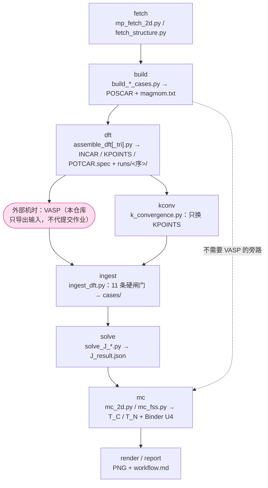

> [!info] 这份文件是什么
> 它是 [`README.md`](README.md) 的**阅读版备份**，由 `python scripts/readme_to_obsidian.py` 生成，正文与 README **逐字一致**（只在前面加了 properties、内链目录、管线图和这段说明）。
> README 改过之后请重跑生成器；`python scripts/readme_to_obsidian.py --check` 是同步闸门（smoke §29 会跑它）。

> [!tip] 在 Obsidian 里怎么用
> 把 `2d_magnet_pipeline` **整个目录当 vault 打开**（Open folder as vault）——这样 `KNOWN_ISSUES.md` / `WORKFLOW.md` / `dsh/2d-magnet/SKILL.md` / `examples/` 这些相对链接都能跳。
> 下面的 mermaid 图与 callout 都是 Obsidian 原生渲染，不需要插件；要交汇报可以用 Obsidian 的 Export to PDF。

## 目录

- [[#Workflow]]
- [[#Install]]
- [[#Quick start]]
- [[#Commands]]
- [[#Outputs]]
- [[#Verification（脚本级自检 / 发布闸门）]]
- [[#Limitations（已知局限）]]
- [[#Roadmap（路线图）]]
- [[#Documentation map（该读哪份）]]
- [[#License]]
- [[#Citation]]

## 管线一览（主链）



---
# 2d-magnet-pipeline

Turn a monolayer structure into exchange constants `J1/J2/J3` and a Monte Carlo estimate of `T_C` / `T_N`, with every number behind a fail-closed gate.

The input is a `POSCAR` — from the Materials Project, from the public COD / OQMD / AFLOW / JARVIS chain, or your own file. The pipeline detects the magnetic lattice, builds the supercell and the magnetic-order set, assembles VASP inputs, ingests the returned `OUTCAR`s, solves the exchange constants, and runs a classical Heisenberg Monte Carlo. There are two routes to J:

- **literature or user-given J → forward Monte Carlo** — no VASP needed;
- **a DFT many-state energy mapping solved back to J** — needs VASP energies.

Supported lattices, all sharing one specification layer and one artifact (`J_result.json`): honeycomb, triangular (120° non-collinear), molecular cluster, two-sublattice ferromagnetic network (Fe₃GeTe₂-like), rectangular (CrSBr-like), C-centred rectangular (CrOCl-like), square (La₂CuO₄ / K₂NiF₄-like), hexagonal kagome (Fe₃Sn-like).

What the pipeline does not do, it says so in [`capabilities.json`](capabilities.json) — `python scripts/capabilities.py --show` prints the readable version:

- no extracted DMI `D` values (`D` enters as an input) — see [`DMI_MTI_MEMO.md`](DMI_MTI_MEMO.md) and `scripts/dmi_matrix.py`;
- no k-resolved band splitting and no `Z₂` classification;
- no altermagnet order-parameter conclusions: `scripts/altermagnet_check.py` only classifies the geometry (交变磁体 geometry check, scalar order parameter only);
- no VASP job submission — the pipeline exports inputs and ingests outputs.

## Workflow

```text
POSCAR    -> fetch     reorient, vacuum                         01_structure/POSCAR
          -> build     lattice, supercell, magnetic orders      02_supercell/cases/
          -> dft       INCAR / KPOINTS / MAGMOM / POTCAR.spec   03_dft/, runs/<order>/
          [ VASP runs outside the pipeline ]
          -> ingest    OUTCAR back, 11 fail-closed checks       cases/<order>/OUTCAR
          -> solve     J1 J2 J3 (meV), states verified           02_supercell/cases/J_result.json
          -> mc        Metropolis + Binder U4 -> T_C / T_N       05_mc/mc_mt.csv, mc_diag.json
          -> render    supercell and order figures              figures/supercell_orders.png
          -> report    provenance card                          workflow.md
```

`kconv` runs only the K-points convergence step (`scripts/k_convergence.py`; `--kpoints` pins a grid). Every stage writes its inputs, provenance and exit status; nothing is derived from a session you cannot re-run.

Three rules keep the numbers honest. No invented parameters: `--S/--moment/--U` fall back to a built-in table for Mn/Cr/Ni/Co/V/Gd only — Fe is deliberately absent because its effective spin is ambiguous (S = 2 / 2.5 / 1), so the driver stops and asks. Unverified literature entries (`null` in `literature_J.json`) raise an error instead of running. And gates fail closed: a failed state verification, a degenerate design matrix, a residual above threshold or a malformed `OUTCAR` aborts the stage — and `--quiet` never swallows the warning that says so.

## Install

```powershell
py -m venv .venv
.venv\Scripts\activate
py -m pip install -r requirements.txt
py run_2d_magnet.py doctor
```

```bash
python3 -m venv .venv
. .venv/bin/activate
python -m pip install -r requirements.txt
python run_2d_magnet.py doctor
```

Requirements: Python ≥ 3.9, `numpy`, `numba`, `matplotlib`, `requests`. `matplotlib` is optional — figures fall back to Pillow (`render-fallback` extra) and, failing that, to a text summary. `doctor` reports what is missing and which error key in [`KNOWN_ISSUES.md`](KNOWN_ISSUES.md) covers it.

The code is also usable as a library: `import run_2d_magnet`, or the console script `2d-magnet` after `pip install .`.

## Quick start

`examples/` holds two complete runs you can reproduce without VASP — literature J in, `T_C` out:

```powershell
py run_2d_magnet.py --model la2cuo4 --poscar tests/fixtures/La2CuO4_POSCAR `
   --outdir C:\work\la2 --skip-dft --mc-size 12 12 --mc-seeds 2
py scripts\solve_J_square.py C:\work\la2\02_supercell\cases --demo
```

`examples/la2cuo4_square/` is the resulting tree; `examples/kagome_fe3sn_dryrun/` is a kagome run through the full DFT shape with synthetic energies. Each has a `README.md` listing what is produced and what is deliberately not.

## Commands

| Subcommand | Does |
|---|---|
| `fetch` | structure from Materials Project / COD / OQMD / AFLOW / JARVIS → `01_structure/POSCAR` |
| `build` | lattice detection, supercell, magnetic-order set → `02_supercell/cases/` |
| `dft` | INCAR / KPOINTS / MAGMOM / POTCAR.spec → `03_dft/`, `runs/<order>/` |
| `ingest` | OUTCAR validation (11 gates) → `cases/<order>/OUTCAR` |
| `kconv` | K-points convergence; only KPOINTS is varied |
| `solve` | many-state energy mapping → `J_result.json` |
| `mc` | Metropolis / Binder U4 → `T_C` or `T_N` |
| `render` | supercell and order figures |
| `report` | provenance card → `workflow.md` |
| `doctor` | environment self-check against `KNOWN_ISSUES.md` |

Presets: `la2cuo4`, `crsbr`, `crocl`, `k2nif4`, `fgt`, `mnps3`, `nio`, `gdi2`. Driver options (`--model`, `--literature`, `--element`, `--S`, `--moment`, `--U`, `--mc-order`, `--mc-seeds`, `--quiet`, `--log`) are listed by `py run_2d_magnet.py <subcommand> --help`.

## Outputs

```text
01_structure/POSCAR              oriented, vacuum-trimmed input
02_supercell/cases/              one directory per magnetic order: POSCAR, magmom.txt, OUTCAR
02_supercell/cases/J_result.json J with provenance: source, confidence, cond(A), residual, E0
02_supercell/cases/states_verification.json   per-site moment check that gates solve
03_dft/, runs/<order>/           INCAR, KPOINTS, POTCAR.spec, MAGMOM
05_mc/mc_mt.csv, mc_mt.png       T, order parameter, susceptibility, Binder U4
05_mc/mc_diag.json               acceptance, tau_int, n_eff, naive vs binned SEM
figures/supercell_orders.png     supercell with exchange bonds and the order set
workflow.md                      provenance card for the run
```

`J_result.json` always records how J was obtained (`source` = `literature` / `user` / `dft` / `demo`), the design matrix conditioning, the residual, and whether the magnetic states were verified per site. A number without that provenance is not a result.

## Verification（脚本级自检 / 发布闸门）

```powershell
py run_2d_magnet.py doctor
py scripts\capabilities.py --check
py tests\smoke_test.py
py tests\check_sdist.py "dist\*.tar.gz"
```

The contract suite is eight test files under `tests/` (`test_magnetic_orders.py`, `test_square_cases.py`, `test_crect_cases.py`, `test_kagome_cases.py`, `test_fgt_e2e.py`, `test_altermagnet.py`, `test_crect_cant.py`, `test_ingest.py`), plus `scripts/magnetic_orders.py --regress` for the positional regression baseline. Script-level self-checks:

```text
python scripts/mc_2d.py --selftest            energy convention, single-ion anisotropy, tau_int
python scripts/mc_fss.py --selftest           crossing choice, 1/L extrapolation
python scripts/verify_states.py --selftest    per-site moments, collapse detection
python scripts/dmi_matrix.py --selftest       DMI matrix vs exchange energy
python scripts/k_convergence.py --selftest    K-points planner
python scripts/readme_to_obsidian.py --check  README backup in sync
```

`solve` runs `scripts/verify_states.py` before inverting anything: if two orders collapse into the same state or a moment contradicts its target, the stage exits non-zero and no `J_result.json` is written.

## Limitations（已知局限）

1. No real DFT data ships with the repository. Every number produced out of the box comes from literature or synthetic energies and is labelled as such — a `T_C`/`T_N` from a demo is not a prediction.
2. The many-state mapping assumes collinear states mapped to a Heisenberg model; non-collinear and SOC cases stop at the coefficient layer (P3), with no verified energies.
3. `S`, `moment` and `U` are inputs. For elements outside the built-in table they must be given explicitly; a guessed value would silently produce wrong physics, so the driver refuses instead.
4. Anisotropy enters only through `--MAE` (default 0) and the DMI matrix; both are inputs, not extracted quantities.
5. Monte Carlo is classical and single-site-update Metropolis on a finite cluster. `T_C`/`T_N` are estimates on that cluster, not thermodynamic-limit values.
6. Error bars come from binned standard errors; `mc_diag.json` reports `n_eff`, `tau_int` and the acceptance rate so an under-sampled sweep is visible. When the peak sits on the window edge, `T` is reported as unresolved instead of being silently trusted.
7. Finite-size scaling uses a global reference crossing and a `1/L` extrapolation as a reference value; it is only meaningful once the scaling window is reached.
8. `--order auto` picks the order parameter from the T = 0 candidate ground states (fm / Néel / stripe). A stripe ground state has no ±1 staggered order parameter, so the pipeline falls back to the specific-heat peak and says so; for anything near-degenerate, pass `--order` explicitly.
9. Kagome is at the coefficient layer (P4.1); the physics layer (P4.2) waits for real non-collinear DFT — see [`P4_2_KAGOME_RUNBOOK.md`](P4_2_KAGOME_RUNBOOK.md).
10. Altermagnets are geometry-classified only (P5); the scalar order parameter reaches sublattice masks, not a full non-collinear description.
11. Canted states (P2′) reach the coefficient layer: `scripts/solve_J_crect_cant.py` takes θ as an input and does not predict it.
12. DMI enters as a `D` matrix you supply; the pipeline does not extract `D` from energies.
13. Ingestion validates format, convergence, structure and conventions — not physics. A clean `ingest_report.md` means the OUTCAR is usable, not that the calculation is right.
14. k-resolved band splitting and `Z₂` are not computed; `kconv` only converges the K-points mesh.
15. Literature entries in `literature_J.json` are starting points. Where an entry is `null` the driver refuses to run instead of inventing a value.
16. The magnetic-state check covers collinear states; it exits `SKIP` (not a pass) for non-collinear or SOC runs.
17. Environment assumptions: Python ≥ 3.9 is checked syntactically, but the suite is exercised on 3.12; `matplotlib` and `requests` are optional and degrade to a documented fallback.
18. Release artifacts are built by `scripts/make_release.py` from the working tree and validated by `tests/check_sdist.py`; the PyPI-style `sdist`/`wheel` build is exercised by the `package` CI job, not on this machine.

## Roadmap（路线图）

`✅ 已完成` = capability implemented and covered by self-checks and regression, **not** physics-verified; `⬜ 待机时` = code and runbook ready, waiting for real DFT machine time.

- ✅ 已完成 · repository hygiene: paths, fixtures, packaging baseline (LICENSE / README / requirements / pyproject)
- ✅ 已完成 · `doctor` self-check and the error catalogue in `KNOWN_ISSUES.md`
- ✅ 已完成 · element parameter table (Mn/Cr/Ni/Co/V) and explicit `--lattice`
- ✅ 已完成 · **P0** shared specification layer: `--lattice` + `magnetic_orders.json`
- ✅ 已完成 · **P1** square lattice: cases, ingest, `J1/J2/J3`, Monte Carlo
- ✅ 已完成 · polynomial `J1/J2/J3` least squares with `cond(A)` and residual diagnostics
- ✅ 已完成 · convergence gates on `encut` / `kpoints` / `sigma`
- ✅ 已完成 · VASP handoff package: INCAR / KPOINTS / POSCAR / POTCAR.spec + run index
- ✅ 已完成 · `doctor` diagnostics: missing dependencies, potential files, k-mesh sanity
- ✅ 已完成 · **P2** C-centred rectangular: CrOCl-like cases, non-collinear MAGMOM
- ✅ 已完成 · **P2′** canted states: `solve_J_crect_cant.py` + runbook
- ✅ 已完成 · **P3** non-collinear and SOC: `LNONCOLLINEAR` / `LSORBIT` / `SAXIS`, canted MAGMOM
- ✅ 已完成 · Binder cumulant `U4` and finite-size scaling (FSS) with a `1/L` reference
- ✅ 已完成 · **P4.1** kagome at the coefficient layer: `√3×√3`, `q = 0`, `3×3`, sublattice nets
- ✅ 已完成 · **P5** altermagnets (MnTe / CrSb): geometry classification + scalar sublattice order parameter
- ✅ 已完成 · per-site magnetic-state verification before any inversion, with collapse detection
- ✅ 已完成 · Monte Carlo sampling diagnostics: acceptance, `tau_int`, `n_eff`, binned SEM
- ✅ 已完成 · machine-readable capability table `capabilities.json` + gate `scripts/capabilities.py --check`
- ✅ 已完成 · release gates: `check_sdist`, `make_release.py`, CI package job
- ⬜ 待机时 · **P4.2** kagome physics layer (Fe₃Sn₂ / Co₃Sn₂S₂ / Mn₃Sn) — needs real non-collinear DFT: submit the `√3×√3` set, ingest `OUTCAR` (`free energy TOTEN`), write `J_result.json`, Monte Carlo for `T_N`. The runbook is ready: [`P4_2_KAGOME_RUNBOOK.md`](P4_2_KAGOME_RUNBOOK.md).

## Documentation map（该读哪份）

| Read | For |
|---|---|
| [`README.md`](README.md) / [`README.zh.md`](README.zh.md) | this manual (English / 中文) |
| [`KNOWN_ISSUES.md`](KNOWN_ISSUES.md) | symptom → fix table, 27 error keys; `doctor` output points here |
| [`WORKFLOW.md`](WORKFLOW.md) | per-stage detail: file by file, option by option |
| [`dsh/2d-magnet/SKILL.md`](dsh/2d-magnet/SKILL.md) | agent skill: conventions, gates, how to drive the pipeline |
| [`capabilities.json`](capabilities.json) | machine-readable capability boundary — lattice, quantity, supported level |
| [`examples/`](examples/) | two complete artifact trees you can inspect without VASP |
| [`P4_2_KAGOME_RUNBOOK.md`](P4_2_KAGOME_RUNBOOK.md) | the kagome physics runbook, ready for machine time |
| [`CHANGELOG.md`](CHANGELOG.md) · [`CITATION.cff`](CITATION.cff) | version history · citation metadata |

Reading this in Obsidian: open the repository folder as a vault and use `README.obsidian.md` (same text, with an internal-link table of contents and a pipeline diagram); the Chinese edition is `README.zh.obsidian.md`. Both are generated — regenerating after a README edit is `python scripts/readme_to_obsidian.py`, and `--check` reports drift.

## License

MIT — see [`LICENSE`](LICENSE).

## Citation

If this pipeline contributed to work you publish, cite it via [`CITATION.cff`](CITATION.cff):

```text
Wu, Sihong. 2d-magnet-pipeline: from a 2D magnet structure to exchange constants
and Monte Carlo T_C / T_N. Version 0.1.0, 2026. MIT license.
```
